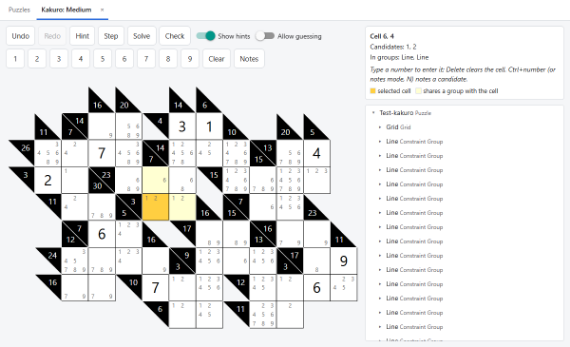

<p align="center">
  
</p>

ConstraintPuzzler - the power of deduction
==========================================

[](https://github.com/JoostvanPinxten/ConstraintPuzzler/actions/workflows/ci.yml)

Many number puzzles have many similar properties which allow automatic (analytical or brute-force) solving. ConstraintPuzzler takes advantage of these similarities by allowing the user to describe the structure of the puzzle. As you can express most puzzles in terms of (combinations of) constraints on this structure, it leverages this information to automatically provide a solver that simply interprets the constraints + structure and analytically solves most cases.

In short, ConstraintPuzzler uses _the power of deduction_ to solve these puzzles.

[](doc/sudokuExample.png) [](doc/kakuroExample.png)

Usage instructions
=================

## Download
Standalone builds for Windows, Linux and macOS are attached to every [GitHub Release](https://github.com/JoostvanPinxten/ConstraintPuzzler/releases); no Python installation is needed. Download the archive for your platform, unpack it and start `ConstraintPuzzler` (`ConstraintPuzzler.exe` on Windows, `ConstraintPuzzler.app` on macOS). A dialog asks which puzzle to open; *Help > About* shows the version.

- **macOS**: the app is not signed, so the first time right-click it and choose *Open*.
- **Linux**: Qt needs the usual X11/Wayland libraries; on Debian/Ubuntu you may have to `sudo apt install libxcb-cursor0`.

## Running from source

ConstraintPuzzler is a Python GUI application. In the root of the project, there are a few `*Main.py` files that start the corresponding GUIs for the puzzles. The supported puzzles are Sudoku, Kakuro, Futoshiki and Sumbrero.

You can also roll your own puzzle, by combining the `UniqueValueConstraint`, `ExactCoverConstraint`, `TotalSumValueConstraint`, `CellGreaterThanCellConstraint`, etc. See [doc/constraints.md](doc/constraints.md) for what each constraint type means, what it deduces and how to set it up, and [doc/puzzle-files.md](doc/puzzle-files.md) for the grid types, the file format of each puzzle and how to define a puzzle in Python.

## Requirements
- Python 3.13 or newer
- [PySide6](https://pypi.org/project/PySide6/) (Qt for Python)
- [uv](https://docs.astral.sh/uv/) to manage the environment (dependencies are declared in `pyproject.toml` and pinned in `uv.lock`)

## Installation
```
uv sync
```
This creates a `.venv` with PySide6 and the development tools.

## Running an example
Start one of the GUIs with its example puzzle:

| Command | Puzzle |
|---|---|
| `uv run python constraintPuzzlerMain.py` | Launcher: one window with a tab per puzzle. Open any number of example puzzles via the start page, *File > Examples* or the **+** button (or your own via *File > Open file*), and close them with the tab's close button (or pass `--puzzle sudoku\|kakuro\|futoshiki\|sumbrero` to open one directly) |
| `uv run python sudokuMain.py` | Sudoku; use *File > Open Sudoku* to load e.g. `easySudoku.txt` or `hardSudoku.txt` |
| `uv run python futoshikiMain.py` | Futoshiki, loads `futoshiki.txt` |
| `uv run python kakuroMain.py` | Kakuro, loads `mediumKakuro.txt` |
| `uv run python sumbreroMain.py` | Sumbrero, loads `simpleSumbrero.txt` |

Press **Solve** to let the solver deduce as much as it can; it keeps applying the constraints until nothing changes anymore. Solving runs in the background: while it runs the button reads **Cancel**, so you can stop it. Some puzzles (e.g. `hardSudoku.txt`) cannot be solved by deduction alone: enable *Solver > Allow guessing (backtracking)* to let the solver try values when it gets stuck (in the launcher this setting applies to all open tabs). If the puzzle turns out to be contradictory, a message explains why.

Selecting a constraint group, constraint or cell in the tree view highlights the corresponding cells in the puzzle, coloured by the role they play (e.g. the smaller and the larger cell of a Futoshiki inequality), and the panel below the tree explains the selection.

To follow the solver instead of letting it finish the puzzle:
- **Hint** points out a cell whose value follows from the rules and explains why, without filling it in.
- **Solve single step** fills in one such cell and explains the deduction, for example "these three cells can only hold 1, 2 and 3 between them, so no other cell in the row can".

The candidate values (the small numbers in open cells) are hidden by default, so they don't give the solution away. Use *View > Show hints* (Ctrl+H) to show them in the cells and in the explanations.

Every change is undoable, including a Solve: use *Edit > Undo* and *Edit > Redo* (Ctrl+Z / Ctrl+Y, or Ctrl+Shift+Z depending on the platform).

Click a cell to select it, then type a number to enter it (given cells cannot be changed). Typed values are shown in green; Delete or Backspace clears them. You can also make mistakes: a value that breaks a rule is drawn in red, together with the cells it clashes with (e.g. the other 6 in the row), and the panel below the tree explains the clash. Mistakes are kept out of the puzzle model, so **Solve** only uses the values that fit.

Each puzzle type has its own file format (see [doc/puzzle-files.md](doc/puzzle-files.md)), read by a parser in `parsers/` such as `parsers.parseKakuroFile`. Each `*Main.py` file contains a subclass of `BasicMainWindow` that names its parser and determines the layout and shapes of the puzzle.

Development
==================

## Project layout
- `structure/` - the puzzle model: `Puzzle`, `Grid` and `Cell`
- `constraints/` - `ConstraintGroup` and the constraint types
- `solver/` - the `Solver`: repeated deduction, with optional backtracking
- `parsers/` - the puzzle file parsers, one per puzzle type
- `utility/` - `PuzzleFactory` for creating (example) puzzles
- `gui/` - the Qt user interface: main window, tree model and puzzle piece shapes

The model, constraints, parsers and solver do not depend on the GUI; the tree view is built from a finished puzzle by `buildPuzzleTree` in `gui/puzzlemodel/puzzletreemodel.py`.

## Tooling and tests
```
uv run pre-commit install            # run ruff (lint + format) on every commit
uv run pre-commit run --all-files    # ruff check, ruff format, file hygiene
uv run pyright                       # type checking
QT_QPA_PLATFORM=offscreen uv run python -m unittest discover -s . -p "test_*.py" -t .
```
The unit tests only exercise the model, constraints and solver, so they do not need PySide6. The GUI smoke tests in `tests/` start each puzzle window headless (`QT_QPA_PLATFORM=offscreen`).

CI (GitHub Actions) runs pre-commit, pyright, and the unit and GUI smoke tests on Linux and Windows for every push to `master` and every pull request. Dependabot keeps GitHub Actions and Python dependencies up to date.

## Versioning and releases
The version lives in one place: `[project].version` in `pyproject.toml`. The app reads it at runtime (`utility/version.py`) and shows it in the window title and *Help > About*.

To cut a release:
```
uv version --bump minor              # or patch / major; also updates uv.lock
git commit -am "Release vX.Y.Z"      # via a pull request
git tag vX.Y.Z && git push origin vX.Y.Z   # after merging, on master
```
Pushing the tag runs `.github/workflows/release.yml`. It checks that the tag matches `pyproject.toml`, builds a PyInstaller bundle on Windows, Linux and macOS, smoke-tests each executable (`--smoke-test`) and publishes the archives as a GitHub Release. If a release for the tag already exists (for example, one you created by hand), the archives are attached to it. Run the workflow manually (*Actions > Release > Run workflow*) for a dry run that only uploads build artifacts.

To build locally: `uv run python -m PyInstaller constraintpuzzler.spec --noconfirm`. The result ends up in `dist/`.

To skip the bulk-formatting commit in `git blame`, run `git config blame.ignoreRevsFile .git-blame-ignore-revs`.

## AI-assisted workflow
The repository uses [Claude Code GitHub Actions](https://github.com/anthropics/claude-code-action):
- **@claude**: mention `@claude` in an issue or PR comment (collaborators only) to ask questions or have it implement changes.
- **PR review**: every non-draft PR gets an automatic review.
- **CI auto-fix**: when CI fails on a PR, Claude proposes a fix PR against that branch.
- **Issue triage**: new issues are labelled automatically, and Claude asks for missing bug-report details.

These require the `CLAUDE_CODE_OAUTH_TOKEN` repository secret (generate it with `claude setup-token`) and the [Claude GitHub App](https://github.com/apps/claude). Repository conventions for Claude are in `CLAUDE.md`.

Working locally with [Claude Code](https://claude.com/claude-code), the project settings in `.claude/` give you:
- a hook that runs ruff fix + format on every Python file Claude edits;
- `/test` to run all CI checks locally and summarise them;
- `/new-constraint` and `/new-puzzle` to scaffold new constraints and puzzle types with tests.

## Contributing
Due to the nature of the ConstraintPuzzler, there are several ways to do some development:
- Creating new puzzles based on pre-defined constraints and cell visualizations;
- Introduce a new kind of Constraint, by implementing the contract defined by the `Constraint` class (`notify`, `applyConstraint` and `getAllowedValuesForValueList`). When a constraint detects that the puzzle cannot be solved anymore, it raises a `ContradictionError`; the solver uses this to backtrack (see [Writing your own constraint](doc/constraints.md#writing-your-own-constraint));
- Create your own fancy shapes for visualizing a puzzle, including animation;
- Improving the main algorithm that distributes the logic to the proper places.

I would be happy to see new kinds of puzzles being tackled, be it with existing constraints or with new ones.

How to report issues
==================
As I am interested in the different usages of the ConstraintPuzzler, I would like to have some background information on the type of puzzle that you are trying to create.

If you report an issue, you may be asked to provide the following technical information:

- Which platform you are using (Linux, Windows, macOS, etc.)
- Which version of Python you are using (e.g. 3.13.1)
- Which version of PySide6 you have installed (e.g. 6.12.0)
- In what way you started your ConstraintPuzzler
