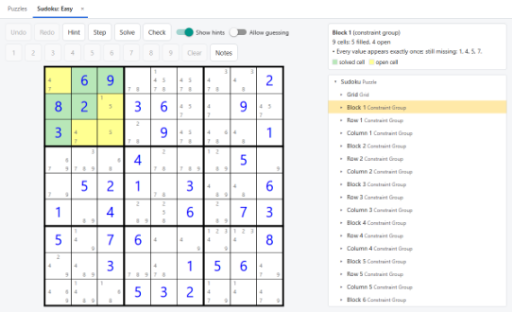

ConstraintPuzzler - the power of deduction
==========================================

[](https://github.com/JoostvanPinxten/ConstraintPuzzler/actions/workflows/ci.yml)

Many number puzzles have many similar properties which allow automatic (analytical or brute-force) solving. ConstraintPuzzler takes advantage of these similarities by allowing the user to describe the structure of the puzzle. As you can express most puzzles in terms of (combinations of) constraints on this structure, it leverages this information to automatically provide a solver that simply interprets the constraints + structure and analytically solves most cases.

In short, ConstraintPuzzler uses _the power of deduction_ to solve these puzzles.

[](doc/sudokuExample.png) [](doc/kakuroExample.png)

Usage instructions
=================

ConstraintPuzzler is a Python GUI application. In the root of the project, there are a few `*Main.py` files that start the corresponding GUIs for the puzzles. The supported puzzles are Sudoku, Kakuro and Futoshiki; Sumbrero is a work in progress.

You can also roll your own puzzle, by combining the `UniqueValueConstraint`, `ExactCoverConstraint`, `TotalSumValueConstraint`, `CellGreaterThanCellConstraint`, etc.

## Requirements
- Python 3.13 or newer
- [PySide6](https://pypi.org/project/PySide6/) (Qt for Python), see `requirements.txt`

## Installation
```
python -m venv .venv
.venv\Scripts\activate          # Windows
source .venv/bin/activate       # Linux / macOS
pip install -r requirements.txt
```

## Running an example
Start one of the GUIs with its example puzzle:

| Command | Puzzle |
|---|---|
| `python sudokuMain.py` | Sudoku; use *File > Open Sudoku* to load e.g. `easySudoku.txt` or `hardSudoku.txt` |
| `python futoshikiMain.py` | Futoshiki, loads `futoshiki.txt` |
| `python kakuroMain.py` | Kakuro, loads `mediumKakuro.txt` |
| `python sumbreroMain.py` | Sumbrero (work in progress), loads `simpleSumbrero.txt` |

Press **Solve** to let the solver deduce as much as it can; it keeps applying the constraints until nothing changes anymore. Some puzzles (e.g. `hardSudoku.txt`) cannot be solved by deduction alone: enable *Solver > Allow guessing (backtracking)* to let the solver try values when it gets stuck. If the puzzle turns out to be contradictory, a message explains why.

Selecting a constraint group, constraint or cell in the tree view highlights the corresponding cells in the puzzle.

Each `*Main.py` file reads a file format specific to the puzzle (the Sudoku and Futoshiki parsers live in `PuzzleFactory.fromSudokuFile` and `PuzzleFactory.fromFutoshikiFile`), and contains a subclass of `BasicMainWindow` that determines the layout and shapes of the puzzle.

Development
==================

## Project layout
- `structure/` - the puzzle model: `Puzzle`, `Grid` and `Cell`
- `constraints/` - `ConstraintGroup` and the constraint types
- `solver/` - the `Solver`: repeated deduction, with optional backtracking
- `utility/` - `PuzzleFactory` for creating (example) puzzles
- `gui/` - the Qt user interface: main window, tree model and puzzle piece shapes

The model, constraints and solver do not depend on the GUI; the tree view is built from a finished puzzle by `buildPuzzleTree` in `gui/puzzlemodel/puzzletreemodel.py`.

## Running the tests
```
python -m unittest discover -v
```
The tests only exercise the model, constraints and solver, so they do not need PySide6.

CI runs lint and the tests on Linux and Windows for every push and pull request.

## AI-assisted workflow
The repository uses [Claude Code GitHub Actions](https://github.com/anthropics/claude-code-action):
- **@claude**: mention `@claude` in an issue or PR comment (collaborators only) to ask questions or have it implement changes.
- **PR review**: every non-draft PR gets an automatic review.
- **CI auto-fix**: when CI fails on a PR, Claude proposes a fix PR against that branch.
- **Issue triage**: new issues are labelled automatically, and Claude asks for missing bug-report details.

These require the `CLAUDE_CODE_OAUTH_TOKEN` repository secret (generate it with `claude setup-token`) and the [Claude GitHub App](https://github.com/apps/claude). Repository conventions for Claude are in `CLAUDE.md`.

## Contributing
Due to the nature of the ConstraintPuzzler, there are several ways to do some development:
- Creating new puzzles based on pre-defined constraints and cell visualizations;
- Introduce a new kind of Constraint, by implementing the contract defined by the `Constraint` class (`notify`, `applyConstraint` and `getAllowedValuesForValueList`). When a constraint detects that the puzzle cannot be solved anymore, it raises a `ContradictionError`; the solver uses this to backtrack;
- Create your own fancy shapes for visualizing a puzzle, including animation;
- Improving the main algorithm that distributes the logic to the proper places.

I would be happy to see new kinds of puzzles being tackled, be it with existing constraints or with new ones.

How to report issues
==================
As I am interested in the different usages of the ConstraintPuzzler, I would like to have some background information on the type of puzzle that you are trying to create.

If you report an issue, you may be asked to provide the following technical information:

- Which platform you are using (Linux, Windows, macOS, etc.)
- Which version of Python you are using (e.g. 3.13.1)
- Which version of PySide6 you have installed (e.g. 6.12.0)
- In what way you started your ConstraintPuzzler
