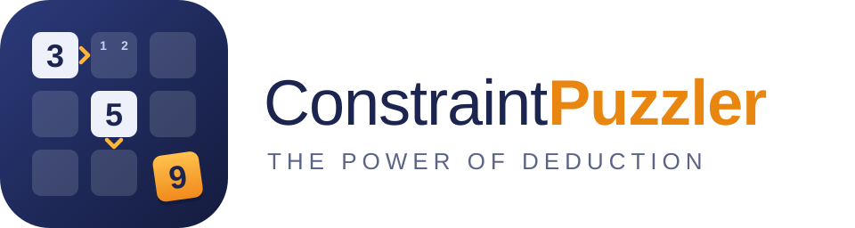

<p align="center">
  
</p>

ConstraintPuzzler - the power of deduction
==========================================

[](https://github.com/JoostvanPinxten/ConstraintPuzzler/actions/workflows/ci.yml)

Many number puzzles have many similar properties which allow automatic (analytical or brute-force) solving. ConstraintPuzzler takes advantage of these similarities by allowing the user to describe the structure of the puzzle. As you can express most puzzles in terms of (combinations of) constraints on this structure, it leverages this information to automatically provide a solver that simply interprets the constraints + structure and analytically solves most cases.

In short, ConstraintPuzzler uses _the power of deduction_ to solve these puzzles. The supported puzzles are Sudoku, Kakuro, Futoshiki and Sumbrero.

[](doc/sudokuExample.png) [](doc/kakuroExample.png)

Usage instructions
=================

## Get the app
ConstraintPuzzler runs in the browser, on Windows, macOS and Linux, and on Android:

- **Web**: play it at <https://joostvanpinxten.github.io/ConstraintPuzzler/>.
- **Desktop**: installers are attached to every [GitHub Release](https://github.com/JoostvanPinxten/ConstraintPuzzler/releases): `.exe`/`.msi` for Windows, `.dmg` for macOS, `.AppImage`/`.deb`/`.rpm` for Linux. The macOS app is not signed, so the first time right-click it and choose *Open*.
- **Android**: install `ConstraintPuzzler-<version>-app-android.apk` from the release. It is debug-signed and not on the Play Store, so allow installing apps from unknown sources.

The start page lists the example puzzles of every type, and *Open file…* opens your own puzzle file (see [doc/puzzle-files.md](doc/puzzle-files.md) for the formats). Every open puzzle gets a tab. The start page also shows the version.

## Playing
Tap or click a cell to select it, then type a number (or use the number pad below the toolbar) to enter it; given cells cannot be changed. Typed values are shown in green; Delete, Backspace or *Clear* removes them. The arrow keys move the selection. You can also make mistakes: a value that breaks a rule is drawn in red, together with the cells it clashes with (e.g. the other 6 in the row), and the info panel explains the clash. Mistakes are kept out of the puzzle model, so **Solve** only uses the values that fit.

You can keep your own candidate notes: press **N** (or the *Notes* button) to switch to notes mode, or hold Ctrl while typing a number, to note it in the selected cell; type it again to remove it.

Press **Solve** to let the solver deduce as much as it can; it keeps applying the constraints until nothing changes anymore. Solving runs in the background: while it runs the button reads **Cancel**, so you can stop it. Some puzzles (e.g. the hard Sudoku) cannot be solved by deduction alone: turn on *Allow guessing* to let the solver try values when it gets stuck. If the puzzle turns out to be contradictory, a message explains why.

To follow the solver instead of letting it finish the puzzle:
- **Hint** reveals a value that follows from the rules, a bit more on every press: first where to look, then the cell, then the value and why. Nothing is filled in.
- **Step** fills in one such cell (the hinted one, if a hint is showing) and explains the deduction, for example "these three cells can only hold 1, 2 and 3 between them, so no other cell in the row can".
- **Check** compares your values and notes with the solution and offers to mark the wrong cells.

The solver's candidate values (the small numbers in open cells) are hidden by default, so they don't give the solution away. Turn on *Show hints* to show them in the cells and in the explanations. The settings are remembered.

Selecting a cell, constraint group or rule in the list of groups and rules highlights the corresponding cells, coloured by the role they play (e.g. the smaller and the larger cell of a Futoshiki inequality), and the info panel explains the selection. Every change is undoable, including a Solve: *Undo* and *Redo* (Ctrl+Z / Ctrl+Y on a keyboard).

You can also roll your own puzzle, by combining the `UniqueValueConstraint`, `ExactCoverConstraint`, `TotalSumValueConstraint`, `CellGreaterThanCellConstraint`, etc. See [doc/constraints.md](doc/constraints.md) for what each constraint type means, what it deduces and how to set it up, and [doc/puzzle-files.md](doc/puzzle-files.md) for the grid types and the file format of each puzzle.

## Running from source
Requirements: [Node.js](https://nodejs.org/) 22 or newer. In the root of the project:
```
npm ci                                       # install everything (npm workspaces)
npm run web -w @constraintpuzzler/app        # the app in the browser
npm run android -w @constraintpuzzler/app    # or ios: with Expo Go or a development build
npm run dev -w @constraintpuzzler/desktop    # the desktop window (needs Rust, see tauri.app)
```

Development
==================

## Project layout
- `packages/core/` - the puzzle engine, in TypeScript and without any UI: the model (`Puzzle`, `Grid`, `Cell`, `Game` with undo and notes), the constraints, the `Solver` (repeated deduction, explained deductions, hints, optional backtracking, cancellable background solving) and the parsers, one per puzzle type, plus the registry of puzzle types
- `app/` - the [Expo](https://expo.dev/) (React Native) app for iOS, Android and the web. `src/logic/` holds the behaviour of a puzzle screen (`PuzzleSession`), the board layout of each puzzle type, the highlight roles and the list of groups and rules, all tested without rendering; `src/components/` draws them (the board with react-native-svg)
- `desktop/` - the desktop app: the web build of `app/` in a [Tauri](https://tauri.app/) window
- `e2e/` - [Playwright](https://playwright.dev/) tests of the web build in a browser
- `puzzles/` - the example puzzle files (bundled into the app by `npm run examples -w @constraintpuzzler/app`)

## Checks and tests
```
npm run typecheck                     # TypeScript, all workspaces
npm run lint                          # ESLint and Prettier (npm run format fixes the formatting)
npm test                              # vitest (engine, with coverage thresholds) and jest (app)
npm run export:web -w @constraintpuzzler/app && npx playwright test   # the web build in Chromium
```
`packages/core/fixtures/` holds the results of the original Python engine for every example puzzle (parsed structure, first deductions, propagation and solution); the engine is still tested against them.

CI (GitHub Actions) runs the type checks, linting and unit tests on Linux and Windows for every pull request, and `app-builds.yml` builds and tests the web version, the desktop installers and the Android APK when the app changes. Dependabot keeps GitHub Actions, npm and Cargo dependencies up to date (the Expo SDK packages are upgraded together, with `npx expo install --fix`).

## Versioning and releases
The version lives in one place: `version` in the root `package.json`. The app (`app/app.config.ts`) and the desktop build (`desktop/src-tauri/tauri.conf.json`) read it from there, and the start page shows it.

To cut a release:
```
npm version minor --no-git-tag-version   # or patch / major
git commit -am "Release vX.Y.Z"          # via a pull request
git tag vX.Y.Z && git push origin vX.Y.Z # after merging, on main
```
Pushing the tag runs `.github/workflows/release.yml`. It checks that the tag matches `package.json`, builds and tests the web version and publishes it on GitHub Pages, builds the desktop installers (Windows, macOS, Linux; the Linux build is started as a smoke test) and the Android APK, and publishes them as a GitHub Release. If a release for the tag already exists (for example, one you created by hand), the files are attached to it. Run the workflow manually (*Actions > Release > Run workflow*) for a dry run that only uploads build artifacts. GitHub Pages uses *GitHub Actions* as its source (*Settings > Pages*); a fork has to set that once.

An iOS build needs an Apple developer account; with one, [EAS Build](https://docs.expo.dev/build/introduction/) can build and submit it from `app/`.

## AI-assisted workflow
The repository uses [Claude Code GitHub Actions](https://github.com/anthropics/claude-code-action):
- **@claude**: mention `@claude` in an issue or PR comment (collaborators only) to ask questions or have it implement changes.
- **PR review**: every non-draft PR gets an automatic review.
- **CI auto-fix**: when CI fails on a PR, Claude proposes a fix PR against that branch.
- **Issue triage**: new issues are labelled automatically, and Claude asks for missing bug-report details.

These require the `CLAUDE_CODE_OAUTH_TOKEN` repository secret (generate it with `claude setup-token`) and the [Claude GitHub App](https://github.com/apps/claude). Repository conventions for Claude are in `CLAUDE.md`.

Working locally with [Claude Code](https://claude.com/claude-code), the project skills in `.claude/` give you:
- `/test` to run all CI checks locally and summarise them;
- `/new-constraint` and `/new-puzzle` to scaffold new constraints and puzzle types with tests.

## Contributing
Due to the nature of the ConstraintPuzzler, there are several ways to do some development:
- Creating new puzzles based on pre-defined constraints and cell shapes;
- Introduce a new kind of Constraint, by implementing the contract defined by the `Constraint` class (`notify`, `applyConstraint`, and the descriptions). When a constraint detects that the puzzle cannot be solved anymore, it throws a `ContradictionError`; the solver uses this to backtrack (see [Writing your own constraint](doc/constraints.md#writing-your-own-constraint));
- Create your own fancy shapes for visualizing a puzzle;
- Improving the main algorithm that distributes the logic to the proper places.

I would be happy to see new kinds of puzzles being tackled, be it with existing constraints or with new ones.

How to report issues
==================
As I am interested in the different usages of the ConstraintPuzzler, I would like to have some background information on the type of puzzle that you are trying to create.

If you report an issue, you may be asked to provide the following technical information:

- Where you run ConstraintPuzzler: the web version (which browser), Windows, macOS, Linux, Android or iOS
- The version, shown on the start page
- The puzzle file, if it is your own
